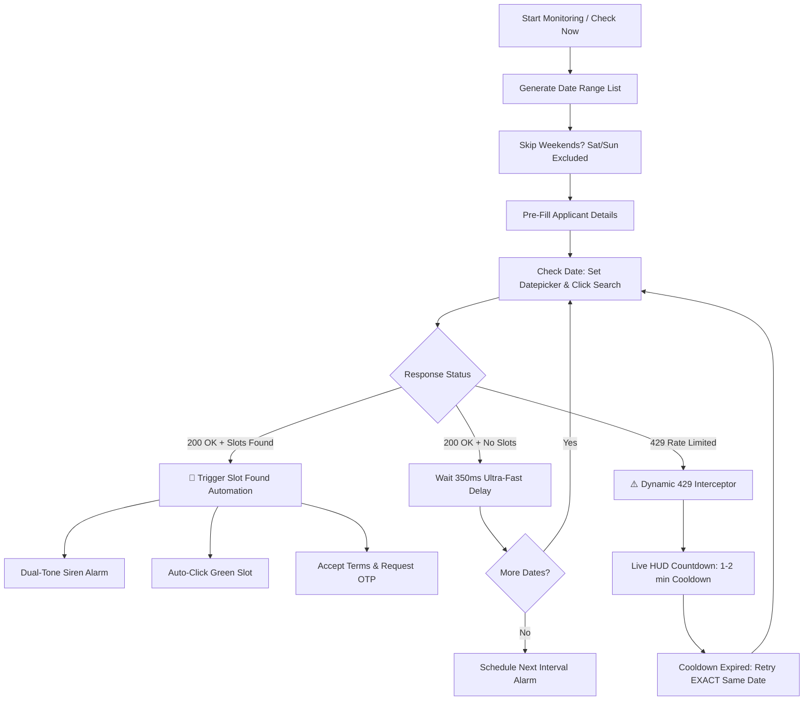

# 🇬🇷 Greece Visa Appointment Bot

[](https://developer.chrome.com/docs/extensions/)
[](https://developer.chrome.com/docs/extensions/mv3/intro/)
[](https://developer.mozilla.org/en-US/docs/Web/JavaScript)
[](LICENSE)

An intelligent, high-speed Chrome Extension built with **Manifest V3** that automates monitoring the **Greece Visa Application Centre (GVCW)** appointment portal (`pk-gr-services.gvcworld.eu`).

Equipped with **multi-layer HTTP 429 rate-limit resilience**, automatic applicant form completion, weekend filtering, and instant dual-tone audio sirens with automated slot reservation triggers.

---

## ⚡ Highlights & Key Features

- **⚡ Ultra-Fast Scanning Mode:** Iterates through dates rapidly with minimal inter-request delay (default `350ms`), letting you beat the queue and detect freshly released slots instantly.
- **🛡️ 3-Layer Dynamic 429 Resilience:**
  - **Network Layer:** Monitored via `chrome.webRequest` in the background service worker.
  - **Runtime & Console Layer:** Intercepted in the page's `MAIN` execution world via `page-bridge.js` (unaffected by Content Security Policy).
  - **Auto-Cooldown & Exact Date Resume:** Automatically pauses all calls, counts down a customizable 1–2 minute cooldown with a live on-screen HUD, and **resumes scanning from the exact same date** where rate limiting occurred.
- **🪪 Automated Applicant Pre-Fill:** Injects Passport Number, Date of Birth, and Passport Expiry into the portal's jQuery datepicker fields before searching.
- **📅 Flexible Date Range & Weekend Exclusion:**
  - Custom Start & End dates or 1-click presets (`+3 Days`, `+7 Days`, `+14 Days`, `+30 Days`).
  - Toggleable **Skip Sat** & **Skip Sun** filters to prevent wasting requests on closed days.
- **🚨 Instant Audio Siren & Auto-Select:**
  - Fires an alternating dual-tone Web Audio API siren immediately upon finding an open slot.
  - Automatically clicks the first available green slot (`.appointment_slot`).
  - Checks Terms & Conditions checkbox (`#submitinfo`).
  - Automatically clicks the Request OTP button (`#btn-onetimepassword`) and focuses the OTP input field for rapid completion.
- **🖥️ Live On-Screen HUD:** Real-time visual overlay pinned to the appointment page showing active search status, current date, and live 429 cooldown countdowns.
- **⏹ Instant Abort Control:** Stopping monitoring from the popup halts all in-flight loops and timers within 100ms.

---

## 🏗️ Architecture & How It Works



---

## 📂 Project Structure

```text
greece-visa-appointment-bot/
├── manifest.json              # Chrome Extension Manifest V3 configuration
├── background/
│   └── service-worker.js      # Alarm scheduler, persistent storage & network 429 listener
├── content/
│   ├── page-bridge.js         # MAIN-world script intercepting XHR, fetch & console logs
│   └── content.js             # Availability scanner, DOM inspector, HUD & slot automation
├── popup/
│   ├── popup.html             # Clean dark-mode extension interface
│   ├── popup.css              # Glassmorphic UI & vector Greek flag styling
│   └── popup.js               # Reactive settings, date presets, and monitoring controls
├── icons/
│   ├── icon-16.png
│   ├── icon-32.png
│   ├── icon-48.png
│   └── icon-128.png           # Pixel-perfect Hellenic Republic flag icons
└── README.md
```

---

## 🚀 Installation

1. **Clone or Download** this repository:
   ```bash
   git clone https://github.com/your-username/greece-visa-appointment-bot.git
   ```
2. Open Google Chrome and navigate to:
   ```text
   chrome://extensions
   ```
3. Enable **Developer mode** using the toggle switch in the top-right corner.
4. Click **Load unpacked** (top-left button).
5. Select the `greece-visa-appointment-bot` directory.
6. The **Greece Visa Bot** icon (🇬🇷) will appear in your Chrome toolbar.

---

## 📖 How to Use

1. Log into your account on the official portal:
   ```text
   https://pk-gr-services.gvcworld.eu/appointments/add
   ```
2. Open the **Greece Visa Bot** extension popup from the toolbar.
3. **Configure Applicant Details (Tab 2: Applicant):**
   - Enter your **Passport Number** (e.g., `YP9894881`).
   - Enter your **Date of Birth** in `DD/MM/YYYY` format.
   - Enter your **Passport Expiry Date** in `DD/MM/YYYY` format.
   - Click **💾 Save Applicant Details**.
4. **Configure Monitoring (Tab 1: Monitor):**
   - **Check Interval:** Choose how frequently checks run (e.g., *Every 5 min*).
   - **429 Cooldown:** Select your rest period when rate-limited (*1.0 min*, *1.25 min [recommended]*, *1.5 min*, *2.0 min*).
   - **Scan Speed:** Select pacing (*⚡ Ultra Fast 350ms*, *🏎️ Fast 600ms*, or *🚶 Balanced 1.0s*).
   - **Dates:** Set Start and End dates or click presets (`+3d`, `+7d`, `+14d`, `+30d`).
   - **Weekend Filters:** Keep `Skip Sat` and `Skip Sun` checked.
5. Click **▶ Start Monitoring** (or click **🔍 Check Right Now** for an instant run).
6. When an appointment is detected:
   - Your computer will sound the alarm.
   - The bot will click the slot and trigger the OTP request.
   - Simply enter your SMS/email OTP and complete booking!

---

## ⚙️ Configuration Reference

| Setting | Options | Recommended | Description |
|---|---|---|---|
| **Check Interval** | `1m`, `2m`, `5m`, `10m`, `15m`, `30m` | `5m` | Background periodic re-check interval via `chrome.alarms` |
| **Scan Speed** | `350ms`, `600ms`, `1000ms` | `350ms` | Inter-date pacing delay between consecutive requests |
| **429 Cooldown** | `60s`, `75s`, `90s`, `120s` | `75s` | Pause duration when hitting embassy server rate limits |
| **Weekend Filter** | `Skip Sat`, `Skip Sun` | `Both Enabled` | Excludes non-working Embassy days to maximize speed |

---

## 🔒 Security & Privacy

- **No Remote Telemetry:** All credentials and applicant details are stored strictly inside your local browser storage (`chrome.storage.local`).
- **No Third-Party Dependencies:** Zero npm runtimes or external CDNs required. Built with vanilla JavaScript, modern DOM APIs, and Web Audio API.

---

## ⚠️ Disclaimer

This tool is created for personal convenience and educational purposes to assist applicants in discovering visa slots. Please ensure compliance with the terms of service of the respective booking portal. Use responsibly.
# greece_visa_appointment_bot
